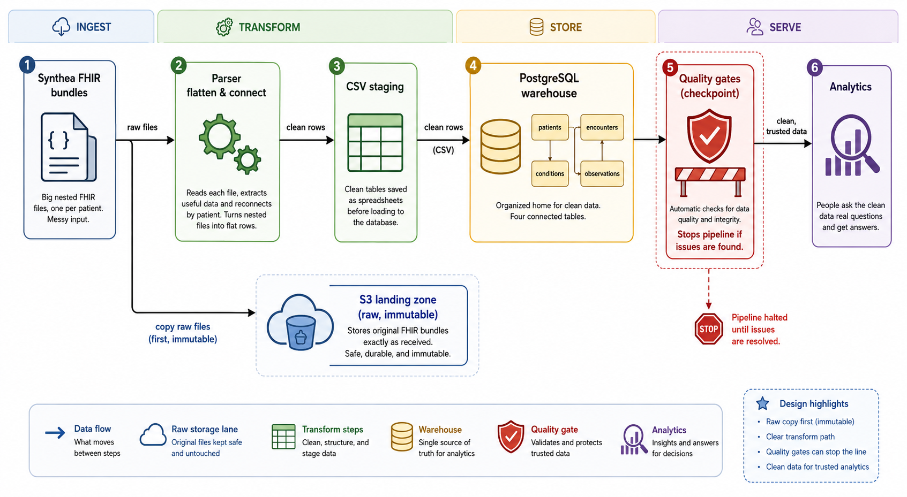

# FHIR → Warehouse Pipeline

A batch pipeline that ingests synthetic **FHIR R4** patient bundles, flattens the
deeply-nested resources into clean relational tables, loads them into
**PostgreSQL**, and lands the raw bundles in an **AWS S3** landing zone — with
data-quality gates and idempotent, re-runnable loads.

> **Data is 100% synthetic**, generated with [Synthea](https://github.com/synthetichealth/synthea). No real PHI, ever.

Built as a portfolio project to demonstrate healthcare data engineering:
turning the FHIR interoperability standard into analytics-ready data the way a
provider or payer actually would.

## Architecture



Raw bundles land in S3 **before** transformation so history can be replayed if
the parser or mapping changes. The CSV staging step keeps the transform
inspectable and unit-testable independently of the database.

## Why FHIR is the hard part

FHIR resources are deeply-nested JSON that reference each other by URN — one
patient's record can be a single 1,400-entry document. The core healthcare-DE
task is turning that into flat, join-able tables without losing the
relationships. This pipeline handles the tricky bits: `urn:uuid` reference
resolution into foreign keys, `value[x]` polymorphism, and exploding
`component[]` panels (e.g. blood pressure) into queryable rows.

## Stack

Python 3 (`json`, `pandas`, `psycopg2`, `boto3`) · PostgreSQL 16 (Docker) ·
AWS S3 · `pytest` · Synthea (FHIR R4)

## Data model

Normalized relational: `patients` (parent) with `encounters`, `conditions`, and
`observations` children, joined by `patient_id` (see `sql/schema.sql`).
A representative run: **61 patients · 4,018 encounters · 2,753 conditions ·
54,774 observations**, zero orphan rows.

## How to run

Prerequisites: Docker, Python 3, Java 11+ (for Synthea). Windows users: see
[`docs/setup_windows.md`](docs/setup_windows.md).

```bash
# 1. install deps
pip install -r requirements.txt

# 2. start local Postgres (publishes on 5431)
docker compose up -d

# 3. generate synthetic data -> data/fhir/   (see docs/synthea.md)
java -jar synthea-with-dependencies.jar -p 50 \
  --exporter.fhir.export true --exporter.fhir.use_us_core_ig true \
  --exporter.baseDirectory ./data Massachusetts

# 4. run the whole pipeline: (S3) -> parse -> load -> DQ
python run.py

# 5. ask the warehouse questions
psql -h 127.0.0.1 -p 5431 -U fhir -d fhir_dw -f sql/analytics.sql

# tests
pytest -q
```

Copy `.env.example` to `.env` for DB/S3 config. Set `S3_BUCKET` to enable the
raw-landing step (AWS creds via `~/.aws`); leave it unset to skip S3.

## Sample output

*Q1 — most common clinical diagnoses (SNOMED `(disorder)` only, so
social-determinant findings don't inflate the counts):*

| diagnosis | patients |
|---|---|
| Gingivitis (disorder) | 53 |
| Viral sinusitis (disorder) | 38 |
| Acute viral pharyngitis (disorder) | 31 |
| Anemia (disorder) | 22 |
| Essential hypertension (disorder) | 20 |

`analytics.sql` also answers: encounter-volume trends by type, care intensity
per patient, latest lab value per patient (window function), and a chronic-disease
cohort — hypertensive patients joined to their latest **eGFR**, flagging reduced
kidney function.

## Data quality

`dq_checks.py` runs after every load with two severities: **blocking** checks
(orphan FKs, deceased-before-birth, future birth dates) fail the pipeline, while
**warning** checks (implausible values) report without halting. A silent bad
load is worse than a failed one.

## Project layout

```
├── run.py                # one-command pipeline: (S3) -> parse -> load -> DQ
├── docker-compose.yml    # local Postgres (port 5431)
├── src/
│   ├── parse_fhir.py     # bundles -> CSVs
│   ├── load_postgres.py  # CSVs -> Postgres (COPY, FK order, atomic)
│   ├── upload_s3.py      # raw bundles -> S3 landing zone
│   └── dq_checks.py      # data-quality gates
├── sql/
│   ├── schema.sql        # DDL: types, PKs, FKs, indexes
│   └── analytics.sql     # 6 clinical/ops questions
├── tests/                # pytest (parser, uploader, DQ)
└── docs/                 # FHIR mapping, setup, AWS
```

## Design principles

- **Simplicity over cleverness** — plain, readable Python a reviewer can follow.
- **Integrity enforced at every layer** — the parser skips orphans, the schema
  declares FKs, and DQ gates re-check after load.
- **Raw is immutable** — land it first, transform second, so history replays.
- **Every design choice has a documented tradeoff**, captured during
  development along with the alternatives considered.
